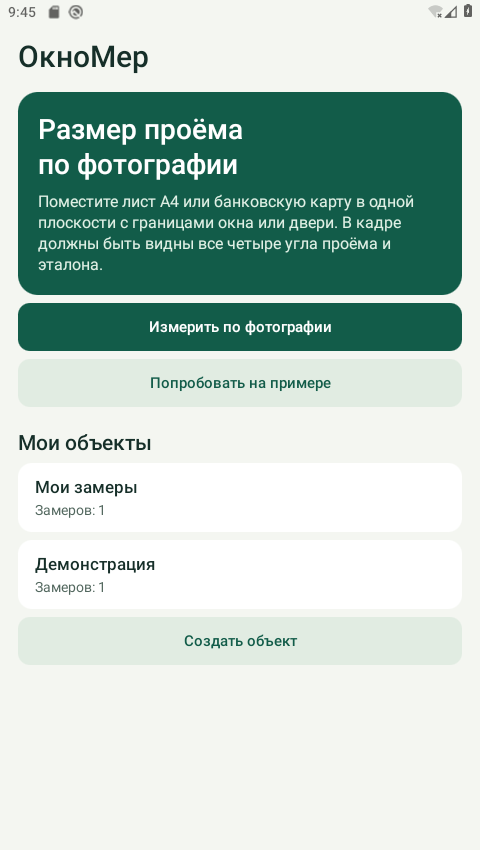
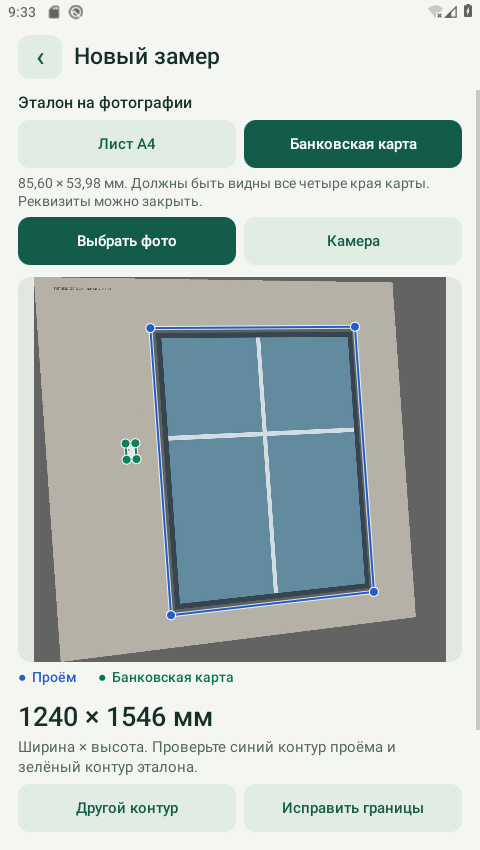

# ОкноМер

Android-приложение для оценки ширины и высоты прямоугольного окна или дверного проёма по одной фотографии. Эталон выбирается для каждого снимка: лист А4 или банковская карта формата ID‑1. Результат отображается в миллиметрах. Все фотографии обрабатываются на устройстве.

**Версия 0.4.0, сборка 5 · Android 10 и новее · Java, OpenCV, SQLite.**

[Соответствие 16 этапам](docs/stages.md) · [Как работает алгоритм](docs/architecture.md) · [Контрольные результаты](docs/results/README.md) · [Натурные испытания](docs/field/README.md)

## Пример замера

Лист А4 (210 × 297 мм) или карта ID‑1 (85,60 × 53,98 мм) находятся в одной плоскости с измеряемым проёмом. Зелёным выделяется эталон, синим — проём. После подтверждения углов приложение сохраняет ширину, высоту и снимок. Встроенная демонстрация доступна на главном экране.

[Четыре примера съёмки](docs/examples/README.md)

## Установка

Подписанный APK устанавливается на Android 10 и новее. При первом открытии скачанного APK Android может запросить разрешение на установку из выбранного источника.

 

## Сборка из исходников

Откройте в Android Studio папку, в которой находятся `settings.gradle` и `gradlew.bat`. Для сборки используются **JDK 17**, Android SDK Platform 35 и Android SDK Build-Tools 35.0.0. Выберите JDK 17 в настройках Gradle, установите указанные компоненты в SDK Manager и дождитесь синхронизации. Для первой загрузки Gradle и зависимостей нужен интернет. Выберите модуль **app** и нажмите **Run**.

Из PowerShell в корне репозитория:

```powershell
.\gradlew.bat :app:assembleDebug
```

Для Linux и macOS команда начинается с `./gradlew`. Если SDK установлен вручную, укажите его путь в `ANDROID_HOME` или задайте `sdk.dir` в локальном файле `local.properties`.

Отладочный APK появится в `app/build/outputs/apk/debug/app-debug.apk`. Его пакет — `org.student.oknomer.debug`; он устанавливается рядом с релизом и ведёт собственную базу. Подписанный APK использует `org.student.oknomer` и прежнюю подпись проекта. Команда `:app:assembleRelease` собирает неподписанный релиз. Приватный ключ хранится отдельно от исходного кода.

## Проверки

Подключите эмулятор Android 10+ или тестовый телефон. Для команд ниже нужны `adb` из Android SDK Platform-Tools и Python 3.9+. Программа проверок создаёт учебные записи в отладочной версии.

```powershell
.\gradlew.bat :app:assembleDebug :app:assembleDebugAndroidTest
adb install -r app/build/outputs/apk/debug/app-debug.apk
adb install -r app/build/outputs/apk/androidTest/debug/app-debug-androidTest.apk
py -3 tools/android_check.py
```

Первая фаза прогоняет контрольные изображения и действия пользователя. Вторая принудительно останавливает приложение и проверяет повторное открытие замера. Каждая успешная фаза выводит `ALL PASSED`. После публикации тот же сценарий настроен в **Actions → Android**. Там же можно скачать собранный отладочный APK.

## Результаты и ограничения

На трёх контрольных ракурсах одного проёма точная разметка дала 1200 × 1500 мм после коррекции. На тех же снимках автоматический выбор наружной рамы вместо внутренней границы дал большие размеры. Для маленькой карты проверены четыре положения и проведены 400 моделируемых попыток с шумом координат. Таблицы разделяют погрешность геометрии и ошибку выбора контура.

Натурная погрешность по рулетке не определена. Для этого подготовлены [протокол и обработка экспорта](docs/field/README.md). На результат влияют выбранная граница, видимость углов, положение эталона относительно проёма и его размер в кадре.

## Структура

| Каталог | Содержимое |
|---|---|
| `app/src/main/java/org/student/oknomer/` | Экраны, импорт фото, автопоиск, геометрия, разметка, база и экспорт |
| `app/src/main/assets/` | Демонстрационные изображения и лицензия OpenCV |
| `app/src/androidTest/` | Android-проверки, семь тестовых JPEG и контрольные координаты |
| `tools/` | Запуск проверок, построение контрольных таблиц, расчёт натурных ошибок |
| `docs/` | Постановка, карта этапов, иллюстрации, результаты и план натурных испытаний |
| `.github/workflows/` | Сборка и тестирование в GitHub Actions |

В истории Git сохранены четыре исходных коммита прототипа на Python. В актуальной ветке `main` находится самостоятельное Android-приложение. Материалы старого прототипа доступны в коммите `fba4bee`.
