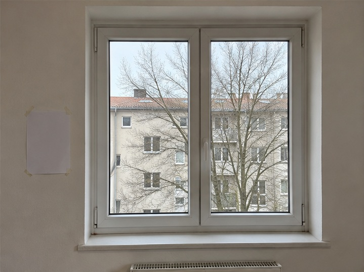
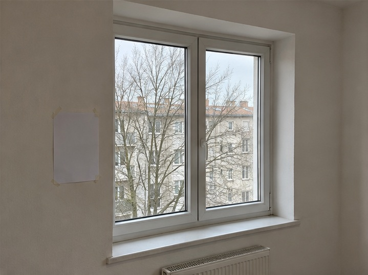
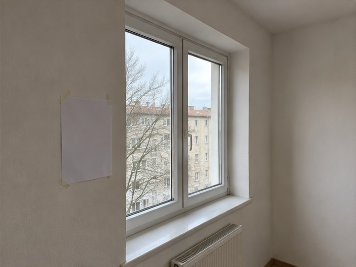
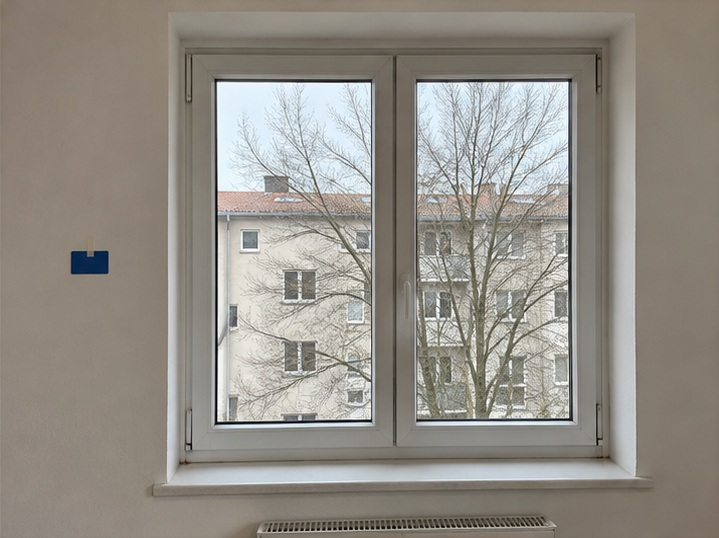

# Примеры съёмки

Четыре синтетические иллюстрации показывают расположение эталона и положение камеры. Физические размеры изображённого окна неизвестны.

| Пример 1 · А4 спереди | Пример 2 · А4 под небольшим углом |
|---|---|
|  |  |

| Пример 3 · А4 сбоку | Пример 4 · Банковская карта |
|---|---|
|  |  |
